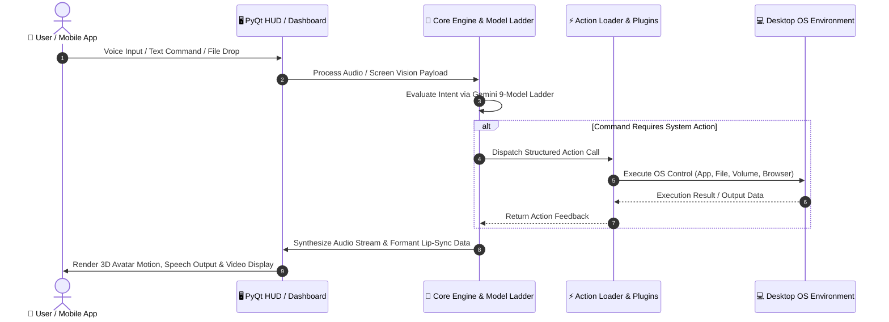

<div align="center">

# 🤖 JARVIS 3.0 — MARK LV (55)
### Next-Generation Autonomous Voice AI & Desktop Cybernetic Assistant

[](https://github.com/Praveen-Suthar-08/JARVIS-3.0-Assistant.git)
[](LICENSE)
[](https://python.org)
[](https://ai.google.dev/)
[](#-installation--quick-start)

<p align="center">
  <a href="API_DOCS.md"><b>📖 API Documentation</b></a> •
  <a href="ARCHITECTURE.md"><b>🏛️ Architecture Deep-Dive</b></a> •
  <a href="CONTRIBUTING.md"><b>🤝 Contributing Guide</b></a> •
  <a href="CODE_OF_CONDUCT.md"><b>📜 Code of Conduct</b></a>
</p>

<p align="center">
  <b>Made with ❤️ by <a href="https://github.com/Praveen-Suthar-08">Praveen Suthar</a></b>
</p>

---

</div>

## 📌 Table of Contents

- [✨ Overview & Philosophy](#-overview--philosophy)
- [🎯 Key Use Cases](#-key-use-cases)
- [⚡ Complete Feature Capabilities](#-complete-feature-capabilities)
- [🏗️ System Architecture](#-system-architecture)
- [📚 Additional Documentation](#-additional-documentation)
  - [📡 API Documentation (API_DOCS.md)](API_DOCS.md)
  - [🏛️ Architecture Specification (ARCHITECTURE.md)](ARCHITECTURE.md)
  - [🤝 Contributing Guide (CONTRIBUTING.md)](CONTRIBUTING.md)
  - [📜 Code of Conduct (CODE_OF_CONDUCT.md)](CODE_OF_CONDUCT.md)
- [📂 Project File Structure](#-project-file-structure)
- [🚀 Installation & Quick Start](#-installation--quick-start)
- [⚙️ Configuration & API Setup](#️-configuration--api-setup)
- [🌐 Web Dashboard & Remote Control](#-web-dashboard--remote-control)
- [🧩 Plugin & Extension Development](#-plugin--extension-development)
- [🔒 Security & Privacy Architecture](#-security--privacy-architecture)
- [⌨️ Global Hotkeys & Controls](#️-global-hotkeys--controls)
- [🤝 Contributing & License](#-contributing--license)

---

## ✨ Overview & Philosophy

**JARVIS 3.0 (Mark LV)** is an ultra-fast, zero-latency, cross-platform personal artificial intelligence system designed to act as your autonomous voice-driven desktop companion. Built upon Google's **Gemini Live API**, JARVIS combines real-time full-duplex voice streaming, visual desktop comprehension, zero-dependency 3D holographic rendering, and deep local system automation.

Unlike standard voice wrappers that depend on heavy cloud subscriptions or sluggish REST polling, **JARVIS 3.0** operates with **sub-second time-to-first-word latency**, native audio formants lip-syncing (~50 FPS visual mouth tracking), local wake-word detection, and an intelligent 9-model auto-failover ladder.

Whether you need hands-free workflow automation, proactive task management, real-time code summaries, screen-aware conversation, or encrypted remote mobile management, JARVIS 3.0 seamlessly turns your operating system into a futuristic cybernetic workstation.

> [!IMPORTANT]
> **Source Repository:** [https://github.com/Praveen-Suthar-08/JARVIS-3.0-Assistant.git](https://github.com/Praveen-Suthar-08/JARVIS-3.0-Assistant.git)  
> Designed, engineered, and maintained by **Praveen Suthar**.

---

## 🎯 Key Use Cases

1. 🎙️ **Hands-Free Desktop Operating System Control**
   - Control applications, volume, display brightness, network connections, system power states, window arrangement, and shortcuts using natural voice commands.
2. 👁️ **Visual Context & Multimodal Screen Analysis**
   - Ask JARVIS to analyze what is currently visible on your display, debug on-screen code, extract text, summarize open web pages, or monitor desktop events.
3. 📺 **Embedded HUD Video & Media Center**
   - Voice-command media search and video playback directly within the HUD screen area (`"Play the new Dune trailer"`). Muted by default with smart auto-mic suppression to prevent self-feedback.
4. 🧠 **Long-Term Memory & Personal Knowledge Graph**
   - Unlimited session persistence with vector memory recall. Fast retrieval of user preferences, ongoing projects, past transcripts, and key facts across restarts.
5. 📱 **Encrypted Remote Mobile Dashboard**
   - Secure AES-256 encrypted web dashboard with QR-code mobile pairing. Issue commands, monitor system diagnostics, send files, and check response logs anywhere on your local network.
6. ⚡ **Autonomous Multi-Step Agent Execution**
   - Delegate complex tasks (e.g. searching flight tickets, organizing local directories, scraping multi-page search results, setting system cron timers) to the autonomous action engine.

---


## ⚡ Complete Feature Capabilities

### 🧑‍🎤 1. Holographic HUD Interface & Lip-Sync Engine
- **Software 3D Mesh Avatar:** Real 3D facial geometry rendered in PySide/PyQt with dynamic lighting without requiring external GPU runtimes.
- **Formant-Driven Lip-Sync:** 50 FPS real-time phoneme matching calculated directly from voice spectrums and text transcripts.
- **Language-Agnostic Unicode Articulation:** Derives mouth closures, spreads, and rounds across Latin, Cyrillic, Greek, and Devanagari scripts seamlessly.
- **Dynamic Reactive HUD:** Audio-synced radial waveforms, cybernetic hue wheel customization, and state-aware gaze tracking.

### 🪜 2. Fault-Tolerant Model Ladder Engine
- **9-Model Auto-Failover:** Automatically cascades calls through a prioritized latency matrix of Gemini models (e.g., `gemini-2.5-flash`, `gemini-2.0-flash`, `gemini-1.5-pro`) on quota limits, timeouts, or network outages.
- **Cooldown Tracking:** Intelligently quarantines failed model endpoints to guarantee uninterrupted system responsiveness.

### 🎙️ 3. Full-Duplex Real-Time Audio & Echo Cancellation
- **Local Wake Word ("Hey Jarvis"):** Offline wake word detection that sleeps completely until invoked, ensuring zero unauthorized audio streaming.
- **Push-to-Talk (Global Hotkey `Ctrl+Space`):** Instant hardware microphone access.
- **Self-Echo Suppression:** Proprietary acoustic signature filtering prevents the assistant from responding to its own speaker output.

### 🔍 4. Multi-Mode Grounded Web & Local Intelligence
- **Intelligent Grounded Search:** Queries Google Search grounding and DuckDuckGo fallback across 5 specialized modes (`news`, `research`, `price`, `compare`, `search`).
- **File & Code Processor:** Summarize, analyze, transform, and debug local files across any file format.
- **OS-Native Scheduled Reminders:** Deep integration with Windows Task Scheduler, macOS LaunchAgent, and Linux systemd.

---

## 🏗️ System Architecture

JARVIS 3.0 uses a modular, decoupled micro-core architecture separating low-level OS bindings, neural speech pipelines, visual rendering, memory storage, and remote dashboard security.

```
                  +---------------------------------------------------+
                  |                 USER INPUT LAYER                  |
                  |  [ Push-To-Talk ] [ "Hey Jarvis" ] [ Cyber Dashboard ] |
                  +-------------------------+-------------------------+
                                            |
                                            v
                  +---------------------------------------------------+
                  |                 CORE HUD INTERFACE                |
                  |        (PyQt6 Hardware-Accelerated Viewport)       |
                  +-------------------------+-------------------------+
                                            |
                         +------------------+------------------+
                         |                                     |
                         v                                     v
       +-----------------------------------+ +-----------------------------------+
       |       SPEECH & VISION PIPELINE    | |      DECISION & AGENT ENGINE      |
       |  • Speech-to-Text (STT Formants)  | |  • Gemini Live 9-Model Ladder    |
       |  • Screen Capture & Vision        | |  • Action Loader & Skill Matrix |
       |  • Echo Guard & Noise Reduction   | |  • Autonomous Agent Executor   |
       +-----------------+-----------------+ +-----------------+-----------------+
                         |                                     |
                         +------------------+------------------+
                                            |
                                            v
       +-------------------------------------------------------------------------+
       |                           ACTION & SYSTEM LAYER                         |
       |  • File Controller   • Hardware Monitor   • App Launcher   • Media HUD |
       |  • Browser Automation• System Commands    • Custom Plugins • Reminders |
       +------------------------------------+------------------------------------+
                                            |
                         +------------------+------------------+
                         |                                     |
                         v                                     v
       +-----------------------------------+ +-----------------------------------+
       |     PERSISTENCE & MEMORY LAYER    | |    AES-256 MOBILE WEB DASHBOARD   |
       |  • Long-Term Vector Memory        | |  • Encrypted WebSocket Server   |
       |  • Config & API Key Vault         | |  • Auth Tokens & Remote Pairing |
       +-----------------------------------+ +-----------------------------------+
```

### Sequence Flow (Mermaid Diagram)



---

## 📂 Project File Structure

```
JARVIS-3.0-Assistant/
├── main.py                     # Primary Application Entry Point & Core Loop
├── ui.py                       # PyQt6 Cybernetic HUD & 3D Holographic Rendering
├── setup.py                    # Automated Dependency Installer & System Setup
├── requirements.txt            # Python Dependencies Manifest
├── LICENSE                     # MIT Open Source License
├── README.md                   # Complete Documentation & Architecture Guide
│
├── core/                       # Neural Engine & Core Components
│   ├── llm_client.py           # Gemini Live API Client & 9-Model Ladder Manager
│   ├── stt.py                  # Real-Time Speech-to-Text Processing
│   ├── tts.py                  # Text-to-Speech & Formant Synthesizer
│   ├── avatar.py               # 3D Avatar Rendering Engine
│   ├── avatar_mesh.py          # Software 3D Facial Geometry & Vertices
│   ├── wake_word.py            # Local Wake Word Listener ("Hey Jarvis")
│   ├── viseme.py               # Lip-Sync Viseme Calculation Engine
│   ├── action_loader.py        # System Tool Registry & Skill Discovery
│   ├── plugin_loader.py        # Dynamic Plugin Runtime Loader
│   ├── audio_devices.py        # Microphone & Speaker Enumeration
│   ├── hotkey.py               # Cross-Platform Global Hotkey Listener
│   ├── confirm.py              # Destructive Action Confirmation Guard
│   ├── undo.py                 # Action Reversion Engine
│   └── echo.py                 # Acoustic Self-Echo Cancellation Guard
│
├── actions/                    # System Capabilities & Tool Execution Modules
│   ├── desktop.py              # Window & Taskbar Desktop Operations
│   ├── open_app.py             # System Application Launcher
│   ├── system_monitor.py       # Hardware Telemetry (CPU, RAM, GPU, Temp)
│   ├── web_search.py           # Grounded Multi-Mode Web Search
│   ├── youtube_video.py        # HUD Video Search & Stream Player (yt-dlp)
│   ├── file_controller.py      # File Search, Read, Write, and Management
│   ├── file_processor.py      # Document Analysis & Summarization
│   ├── screen_processor.py    # Desktop Vision Capture & Analysis
│   ├── reminder.py             # OS Task Scheduler & Notifications
│   ├── weather_report.py       # Live Weather Data Integration
│   ├── flight_finder.py        # Autonomous Flight Data Retrieval
│   ├── send_message.py         # Messaging Integrations (WhatsApp, Telegram)
│   ├── dev_agent.py            # Autonomous Coding & Agent Mode
│   └── proactive.py            # Context-Aware Check-ins & Briefings
│
├── memory/                     # Persistence & Vector Search
│   ├── memory_manager.py       # User Knowledge Storage & Vector Lookup
│   └── config_manager.py       # User Preferences & Persistent Settings
│
├── dashboard/                  # Remote Encrypted Web Dashboard
│   ├── server.py               # Fast WebSocket & HTTP Security Server
│   └── static/
│       ├── app.html            # Main Futuristic Cyber Dashboard Web Interface
│       ├── login.html          # Secure Encryption Key Entry Interface
│       └── crypto-js.min.js    # Client-Side AES-256 Encryption Library
│
├── config/                     # System Settings & Credentials Vault
│   ├── api_keys.json           # Secure Configuration & API Key Storage
│   └── certs/                  # SSL/TLS Certificates for HTTPS Dashboard
│
└── plugins/                    # User Custom Extensions Directory
    └── _template.py            # Plugin Boilerplate Template
```

---

## 🚀 Installation & Quick Start

### Prerequisites

- **Python Version:** Python 3.10, 3.11, or 3.12 (64-bit recommended).
- **Google Gemini API Key:** Get a free API key from [Google AI Studio](https://aistudio.google.com/).
- **Supported OS:** Windows 10/11, macOS 12+, or modern Linux distributions (Ubuntu/Debian/Arch).

### Step-by-Step Installation

1. **Clone the Repository:**
   ```bash
   git clone https://github.com/Praveen-Suthar-08/JARVIS-3.0-Assistant.git
   cd JARVIS-3.0-Assistant/Mark-LV-main
   ```

2. **Create a Virtual Environment (Recommended):**
   ```bash
   # Windows
   python -m venv venv
   .\venv\Scripts\activate

   # macOS / Linux
   python3 -m venv venv
   source venv/bin/activate
   ```

3. **Install Dependencies:**
   ```bash
   python setup.py
   ```
   *Or install manually via pip:*
   ```bash
   pip install -r requirements.txt
   ```

4. **Launch JARVIS:**
   ```bash
   python main.py
   ```

---

## ⚙️ Configuration & API Setup

Upon first startup, JARVIS will prompt you for configuration details if they are not already set. Alternatively, you can edit `config/api_keys.json` directly:

```json
{
  "GEMINI_API_KEY": "AIzaSyYourActualGeminiApiKeyHere",
  "USER_NAME": "Praveen Suthar",
  "ASSISTANT_NAME": "JARVIS",
  "VOICE_NAME": "Puck",
  "HUD_THEME_COLOR": "#00f2fe",
  "DASHBOARD_PASSCODE": "123456"
}
```

---

## 🌐 Web Dashboard & Remote Control

JARVIS 3.0 includes an encrypted web management dashboard accessible from any browser or smartphone on your local network.

- **URL:** `https://localhost:8443` (or `https://<YOUR-LOCAL-IP>:8443`)
- **Security:** End-to-end **AES-256-CBC encryption** powered by CryptoJS with session token authentication.
- **Features:** Real-time log streaming, remote voice wake, file attachments, and direct text interaction.

---

## 🧩 Plugin & Extension Development

Adding custom capabilities to JARVIS 3.0 requires creating a single Python file inside the `plugins/` folder.

### Example Plugin (`plugins/spotify_control.py`):

```python
"""
JARVIS 3.0 Plugin — Spotify Media Control
"""

TOOL = {
    "name": "spotify_control",
    "description": "Control Spotify music playback (play, pause, next, previous).",
    "parameters": {
        "type": "object",
        "properties": {
            "command": {
                "type": "string",
                "enum": ["play", "pause", "next", "previous"],
                "description": "Playback control command."
            }
        },
        "required": ["command"]
    }
}

def execute(command: str) -> str:
    """Executed automatically when JARVIS calls this tool."""
    # Custom automation code here...
    return f"Spotify playback command '{command}' executed successfully."
```

Restart JARVIS, and the new tool will be auto-discovered and registered into the system prompt!

---

## 🔒 Security & Privacy Architecture

- 🛡️ **Offline Local Wake Word:** Audio is analyzed strictly on your local machine using lightweight energy detection. Audio streams to Google Gemini API **only** after activation.
- 🔐 **Zero Cloud Credential Storage:** API keys remain strictly local in your local `config/api_keys.json`.
- ⚠️ **Action Confirmation Safeguards:** Irreversible operations (system shutdowns, file deletions, Wi-Fi toggles) require physical button confirmation on your screen.

---

## ⌨️ Global Hotkeys & Controls

| Shortcut | Description |
|---|---|
| `Ctrl + Space` | Hold for **Push-to-Talk** global voice command |
| `Esc` | Cancel current video playback or stop active speech |
| `Double Click HUD` | Open customization settings panel |
| `Right Click HUD` | Open system telemetry & memory manager |

---

## 🤝 Contributing & License

Contributions, bug reports, and feature requests are always welcome! Feel free to open an issue or pull request on the [GitHub Repository](https://github.com/Praveen-Suthar-08/JARVIS-3.0-Assistant.git).

This project is licensed under the **MIT License**.

<div align="center">

---

### 👨‍💻 Developed & Maintained by

**Praveen Suthar**  
[](https://github.com/Praveen-Suthar-08)

*“JARVIS 3.0 — Turn your desktop into a cybernetic command center.”*

</div>
